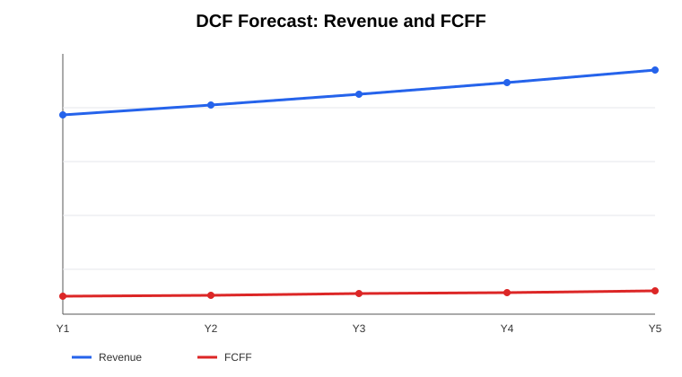

# Financial Modeling & DCF Valuation

A five-year corporate-finance model built from operating assumptions through free cash flow and equity value.



## Base assumptions

- Revenue growth: 6.0%
- EBIT margin: 15.0%
- Tax rate: 29.5%
- D&A / Sales: 3.0%
- CAPEX / Sales: 4.0%
- NWC / Sales: 10.0%
- WACC: 10.5%
- Terminal growth: 3.0%
- Net debt: 220

## Model logic

The forecast covers Revenue, EBITDA, EBIT, taxes, NOPAT, D&A, CAPEX, NWC and FCFF.

```text
NOPAT = EBIT × (1 - Tax Rate)
FCFF = NOPAT + D&A - CAPEX - ΔNWC
Terminal Value = FCFF_(n+1) / (WACC - g)
Enterprise Value = PV(Explicit FCFF) + PV(Terminal Value)
Equity Value = Enterprise Value - Net Debt
```

Base-case enterprise value is **1,403.32** and equity value is **1,183.32** in illustrative monetary units.

## Sensitivity

The model recalculates equity value across WACC values from 9.0% to 12.0% and terminal growth from 2.0% to 4.0%. I use this table to see how much of the result depends on cost of capital and the terminal-value assumption.

## Files

- `dcf_case.py` — full forecast, valuation, sensitivity matrix and chart generation.
- `dcf_model.py` — shorter implementation of the same DCF logic.
- `outputs/dcf_forecast.csv` — forecast schedule.
- `outputs/dcf_sensitivity.csv` — WACC / terminal-growth sensitivity.
- `outputs/dcf_forecast.svg` — forecast chart.

## Run

```bash
pip install -r requirements.txt
python dcf_case.py
```

All assumptions are illustrative and no confidential employer or client data is used.
