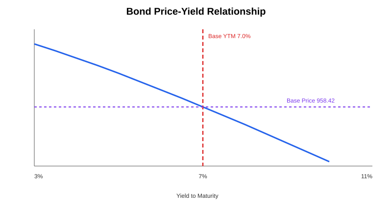

# Fixed Income & Bond Analytics

A compact bond model for pricing and interest-rate sensitivity.



## Base case

- Face value: 1,000
- Annual coupon: 6.0%
- YTM: 7.0%
- Maturity: 5 years
- Coupon frequency: semiannual

The model returns:

- Price: **958.42**
- Macaulay duration: **4.38 years**
- Modified duration: **4.23 years**
- Convexity: **21.46**

## Method

Each contractual cash flow is discounted at the periodic YTM. Duration measures first-order price sensitivity and convexity captures the curvature of the price-yield relationship.

```text
Bond Price = Σ CF_t / (1 + y/m)^t
Macaulay Duration = Σ[t × PV(CF_t)] / Price
Modified Duration = Macaulay Duration / (1 + y/m)
```

## Files

- `bond_analytics.py` — pricing, duration, convexity and price-yield curve.
- `outputs/bond_price_yield.svg` — price-yield chart.

## Run

```bash
pip install -r requirements.txt
python bond_analytics.py
```

Inputs are illustrative and intended for portfolio and study purposes.
