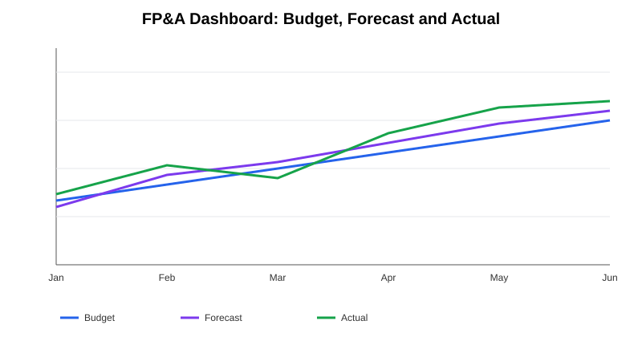

# FP&A — Budget, Forecast & Variance Analysis

A small FP&A case built around one practical question: where is actual spending moving away from plan?



## Analysis

The dataset compares monthly budget, forecast and actual values and calculates:

- absolute variance vs. budget;
- variance % vs. budget;
- forecast error;
- forecast error %;
- total budget vs. total actual.

The output is meant to support the next management question rather than stop at the calculation: which month or cost movement should be investigated first?

## Files

- `fpna_analysis.py` — illustrative dataset and variance calculations.
- `fpna_dashboard.py` — output export and chart generation.
- `outputs/fpna_dashboard.svg` — trend chart.

## Run

```bash
pip install -r requirements.txt
python fpna_analysis.py
python fpna_dashboard.py
```

All figures are illustrative and contain no employer information.
