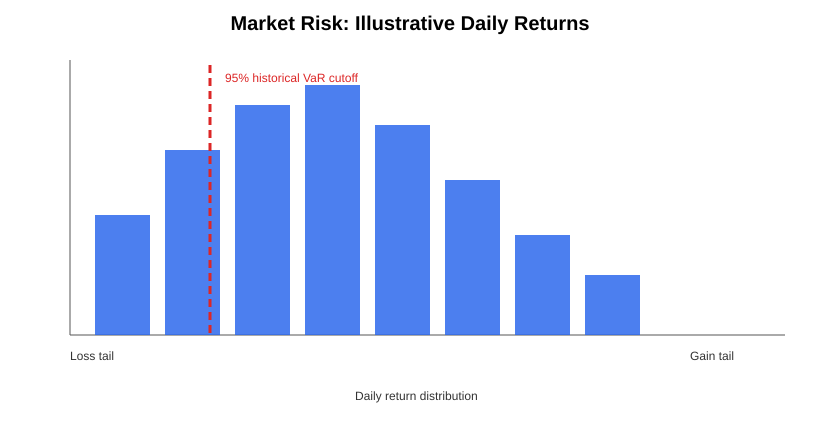

# Market Risk — Value at Risk (VaR)

A simple comparison of parametric and historical VaR for an illustrative portfolio.



## Base case

- Portfolio value: 10,000,000
- Daily volatility: 0.12%
- Confidence level: 95%
- Holding period: 10 days

Results from the current inputs:

- Parametric 10-day VaR: approximately **62,418**
- Historical 1-day VaR: approximately **28,000**

## Method

Parametric VaR assumes normally distributed returns and scales volatility with the square root of time.

```text
VaR = Portfolio Value × z × Daily Volatility × √Holding Period
```

Historical VaR ranks losses from the illustrative return sample and selects the loss corresponding to the chosen confidence level.

The two figures are not directly comparable in this example because the parametric estimate uses a 10-day horizon while the historical estimate is one day. I keep both horizons visible to avoid treating unlike measures as the same risk number.

## Files

- `var_analysis.py` — VaR functions.
- `var_dashboard.py` — output export and return-distribution chart.
- `outputs/var_distribution.svg` — distribution chart.

## Run

```bash
pip install -r requirements.txt
python var_analysis.py
python var_dashboard.py
```

The return series and portfolio value are illustrative.
